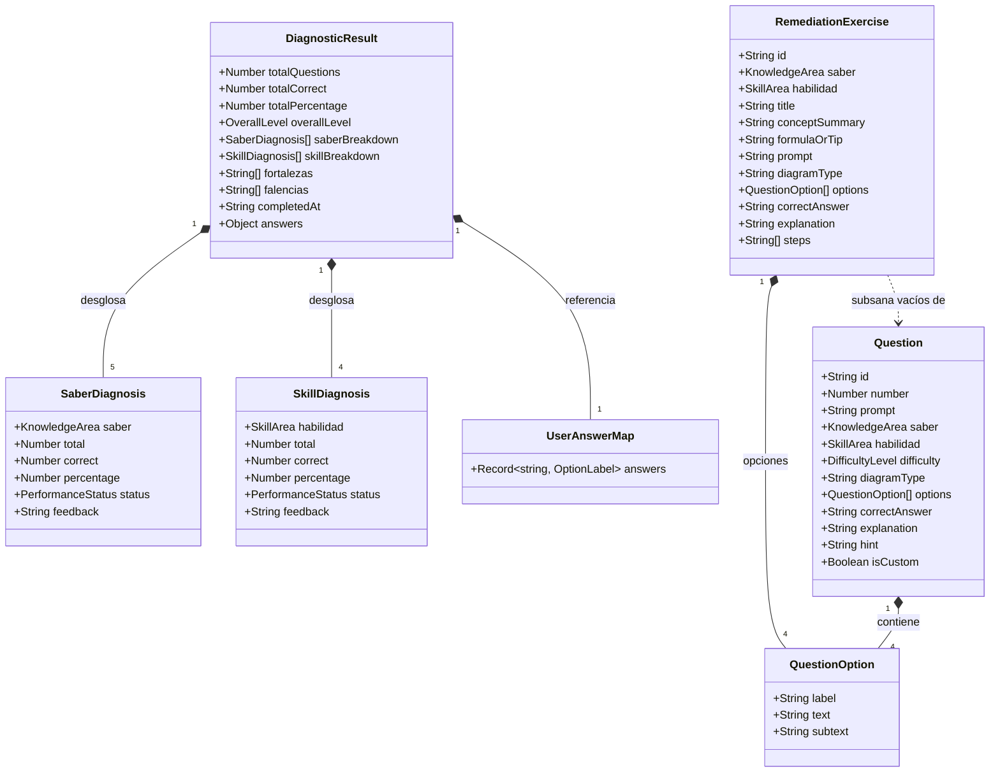
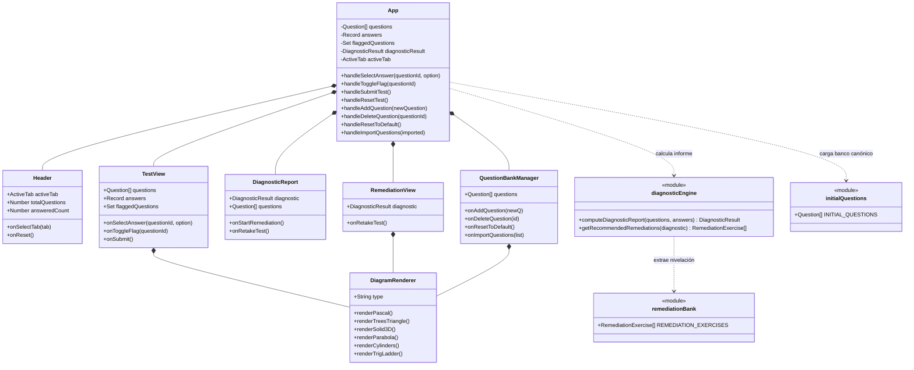
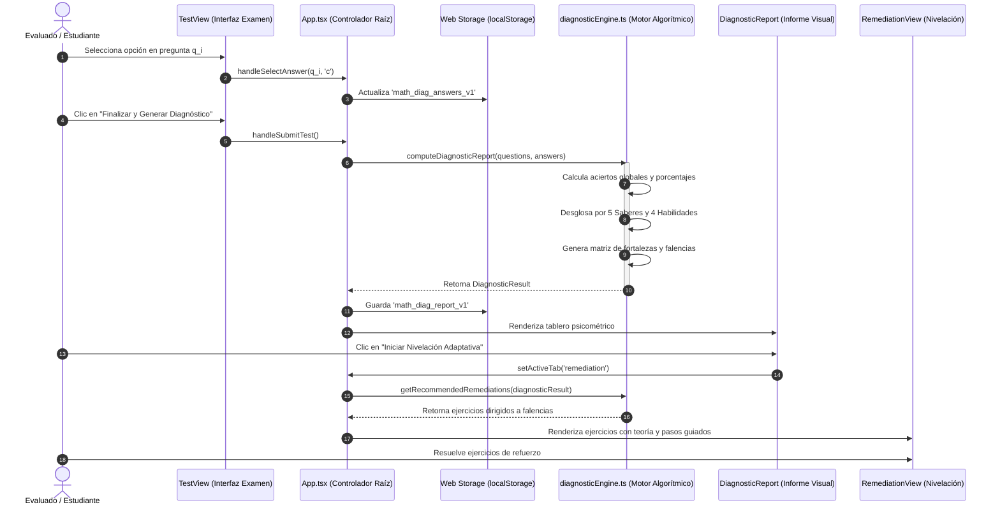
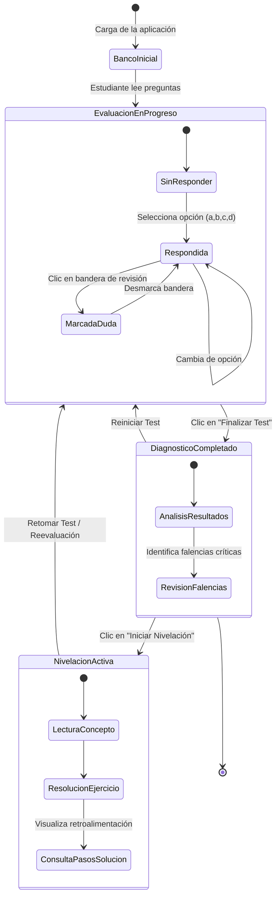

# REGISTRO DE PROPIEDAD INTELECTUAL Y DIAGRAMA DE ARQUITECTURA
## DIAGRAMA DE CLASES Y MODELO DE COMPONENTES — MATEMÁTICAS DIAGNÓSTICO & REFUERZO ADAPTATIVO

---

**INFORMACIÓN FORMAL DEL REGISTRO**
* **Nombre Comercial del Software:** Matemáticas Diagnóstico & Refuerzo Adaptativo — Plataforma de Evaluación Diagnóstica y Nivelación de Competencias Matemáticas
* **Autor y Creador de la Obra:** Daniel Vick
* **Versión del Software:** 1.0.0
* **Clasificación del Software:** Aplicación web interactiva, sistema psicométrico de diagnóstico matemático y nivelación adaptativa
* **Fecha de Documentación:** 20 de Noviembre de 2026
* **Licencia:** Derechos Reservados del Autor / Registro de Soporte Lógico DNDA (Ley 23 de 1982 & Decisión Andina 351)

---

## 1. INTRODUCCIÓN Y MODELO DE ENTIDADES

Este documento formaliza la estructura de datos, contratos de interfaz, relaciones de agregación y el modelo de componentes del sistema **Matemáticas Diagnóstico & Refuerzo Adaptativo**.

Siguiendo el paradigma funcional moderno de React 19 y TypeScript 7, las entidades del modelo son modeladas como **interfaces inmutables de datos**, mientras que la lógica de transformación y orquestación se encapsula en **módulos de funciones puras** y **componentes de interfaz de usuario**.

### 1.1 Diagrama UML de Clases y Entidades del Modelo

### 1.2 Enumeraciones y Tipos del Dominio

* **KnowledgeArea:** `'Aritmética'` | `'Geometría'` | `'Trigonometría'` | `'Álgebra'` | `'Cálculo'`
* **SkillArea:** `'Habilidades básicas'` | `'Procesos de pensamiento y razonamiento'` | `'Habilidades especiales'` | `'Habilidades de análisis'`
* **DifficultyLevel:** `'Básico'` | `'Intermedio'` | `'Avanzado'`
* **PerformanceStatus:** `'Dominio Alto'` | `'Aceptable'` | `'Falencia Crítica'`
* **OverallLevel:** `'Sobresaliente'` | `'Competente'` | `'Requiere Refuerzo'` | `'Alerta Pedagógica'`

---

## 2. DIAGRAMA DE COMPONENTES REACT Y MÓDULOS DE SERVICIO

El sistema organiza sus responsabilidades visuales y lógicas de forma modular:

---

## 3. DIAGRAMA DE SECUENCIA: FLUJO DE DIAGNÓSTICO Y NIVELACIÓN

---

## 4. DIAGRAMA DE ESTADOS: CICLO DE VIDA DE LA SESIÓN

---

## 5. ESPECIFICACIÓN DETALLADA DE LAS RELACIONES

1. **Relación `Question` - `QuestionOption` (Composición $1:4$):** Cada pregunta contiene forzosamente 4 opciones discretas identificadas de forma alfabética (`a`, `b`, `c`, `d`).
2. **Relación `DiagnosticResult` - `SaberDiagnosis` (Composición $1:5$):** El resultado desglosa exhaustivamente los 5 saberes curriculares obligatorios: Aritmética, Álgebra, Geometría, Trigonometría y Cálculo.
3. **Relación `DiagnosticResult` - `SkillDiagnosis` (Composición $1:4$):** El resultado evalúa de forma ortogonal las 4 habilidades cognitivas evaluadas: Básicas, Razonamiento, Especiales y Análisis.
4. **Relación `DiagramRenderer` - `Question` (Asociación Débil $0..1$):** El motor renderiza el diagrama correspondiente si la pregunta define un valor en la propiedad `diagramType`.
5. **Relación `diagnosticEngine` - `remediationBank` (Dependencia Funcional):** La función `getRecommendedRemediations` consulta el banco canónico de ejercicios correctivos para extraer aquellos cuyo saber o habilidad coinciden con los conjuntos de falencias críticas ($P < 70\%$).
